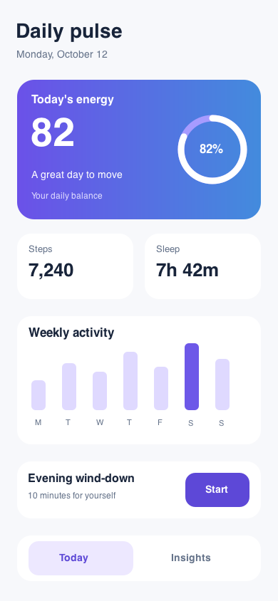
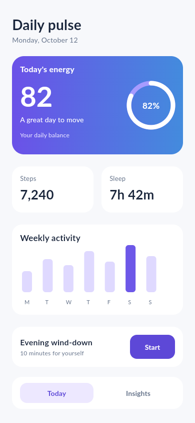
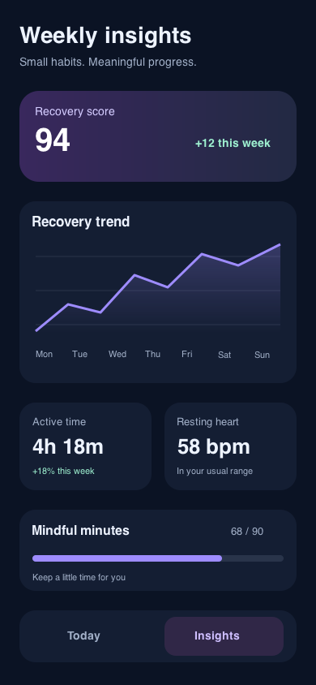
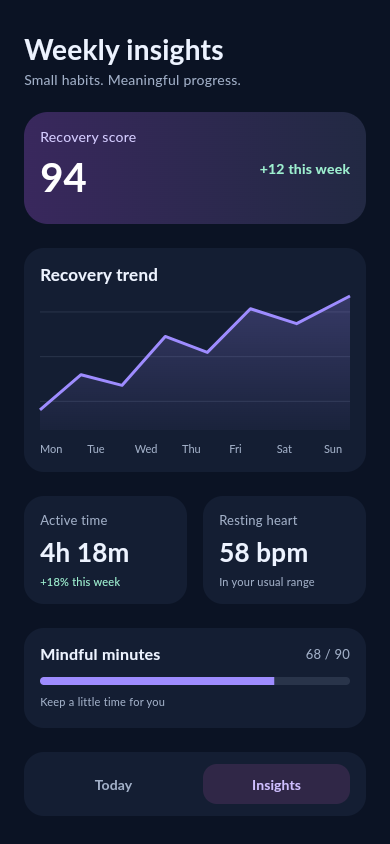
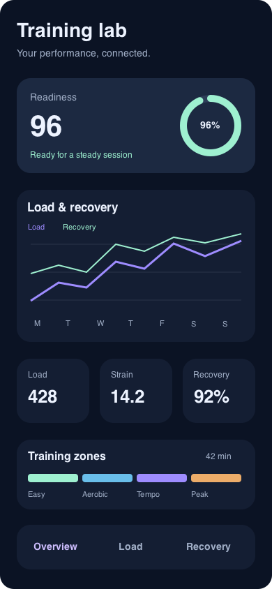
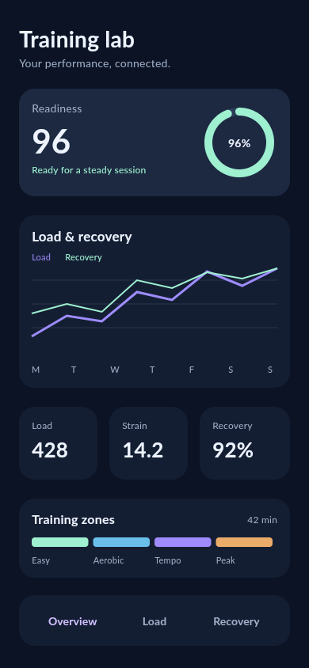

# Flutter Fidelity

Turn a design PNG into maintainable Flutter UI, then measure the result with
reproducible screenshots, pixel comparisons, and region-level reports.

Screenshot-first Flutter UI development with an existing vision-capable coding
assistant. PNGs are the visual authority; Figma/Sketch metadata is optional.

This repository provides a working TypeScript CLI/MCP server, four agent skills,
a Dart development capture harness, an example Flutter screen, twelve screenshot
fixtures, a comparator calibration runner, and interactive HTML reports.

**The assistant generates and repairs Dart.** The CLI performs deterministic
imports, captures and comparisons; it is not a standalone model runner. No
universal 1:1 accuracy is claimed. It reports exact differences and remaining
uncertainty rather than hiding them in an “accuracy” score.

## Quick start

Requires Node 22+; Flutter is required only for capture. Use a pinned SDK. Official
Dart MCP additionally needs a Dart SDK supporting `dart mcp-server`.

```sh
npm ci
npm run build
npm test
node dist/cli.js doctor
node dist/cli.js suggest-viewport --image your-screen.png
node dist/cli.js import-image --image your-screen.png --out .fidelity/reference \
  --width 390 --height 844 --confirmed --fonts ./fonts/Lato-Regular.ttf ./fonts/Lato-Bold.ttf \
  --assets ./assets/hero.png
```

Confirm logical dimensions and app-content crop with the developer; a PNG can be
an export at 2x/3x. `--crop x,y,width,height` uses original PNG pixels. Inputs are
copied and hashed. Existing bundle/run directories are never overwritten.
Missing fonts permit inspection, but the result remains incomplete.

Connect `node /absolute/path/to/dist/cli.js mcp` to your coding assistant as a
stdio MCP server. Load the skills under `skills/`, or use the local plugin
manifests after `npm ci && npm run build`. See [setup](docs/setup.md) and
[workflow](docs/workflow.md) for the full screenshot-to-Flutter loop.

The repository-owned skills are:

- [Screenshot to Flutter](skills/screenshot-to-flutter/SKILL.md): PNG intake, layout generation and vector chart reconstruction.
- [Typography fidelity](skills/flutter-typography-fidelity/SKILL.md): font bytes, weights, glyphs and measured text.
- [Visual repair](skills/flutter-visual-repair/SKILL.md): bounded corrections, retained candidates and behavioral verification.
- [Fidelity verification](skills/flutter-fidelity-verification/SKILL.md): native captures, interactions, accessibility and runnable deliverables.

The assistant inspects the screenshot, saves a reviewed visual spec, generates
real Flutter widgets and a capture entrypoint, then uses:

```sh
node dist/cli.js inspect --bundle .fidelity/reference --spec visual-spec.json
node dist/cli.js capture --bundle .fidelity/reference --config capture.json --out .fidelity/capture-1
node dist/cli.js compare --bundle .fidelity/reference --actual .fidelity/capture-1/actual.png \
  --capture .fidelity/capture-1/capture.json --out .fidelity/report-1
node dist/cli.js record-iteration --session .fidelity/session.json --report .fidelity/report-1
```

Open `.fidelity/report-1/index.html` for overlay opacity, blink inspection,
difference maps, region metrics, policy, environment and unresolved issues.
Compare exits **0 = passed**, **1 = failed**, **2 = incomplete**. A design-fidelity
pass is separate from interaction, accessibility and responsive acceptance.

## Validate and benchmark

```sh
npm run check
npm run fixtures
npm run benchmark
```

The default benchmark is **comparator calibration**, not model generation
accuracy: it checks twelve references against deliberate defects. Identical PNGs
without real capture evidence remain incomplete. To evaluate generated Flutter
from different assistants, use a real capture manifest:

```sh
npm run benchmark -- --manifest your-runs.json --out .fidelity/agent-evaluation
```

See [benchmark protocol](docs/benchmark.md) and [verification results](docs/verification.md). The source fixtures are synthetic
screenshots with separately licensed Lato fonts, not recovered Figma documents.

## Flutter example

```sh
cd flutter/example
flutter pub get
cd ../..
node dist/cli.js import-image --image fixtures/screens/complete-screen.png \
  --out .fidelity/example-reference --width 390 --height 844 --confirmed \
  --fonts fixtures/fonts/Lato-Regular.ttf fixtures/fonts/Lato-Bold.ttf
node dist/cli.js capture --bundle .fidelity/example-reference \
  --config examples/capture.widget.json --out .fidelity/example-capture
```

The example is an independently implemented demonstration of capture, not a
claim that it already matches the fixture. Comparing it exposes differences to
repair. For native Android/iOS, add platform scaffolding with `flutter create
--platforms=android,ios .` in the example, configure a simulator/emulator and use
the integration capture/driver. Native font bytes must match the bundle.

## V1 boundaries

Local assistant workflow, screenshot inputs, and Flutter mobile UI. Runtime code
does not depend on the capture harness. Backend generation, native platform
views and complex animation/shaders are outside v1. Figma/Sketch adapters and an
independent model-API runner are not part of this screenshot-first release.

## UI examples: design PNG versus Flutter

The bundled **Open Wellness** designs are original, free-to-reuse UI references
released under CC0. They are rendered independently from editable design sources,
then implemented as real Flutter widgets. All screenshots below use a 390×844
app-content viewport. No screenshot is embedded as the Flutter UI.

### Daily pulse

Progress ring, gradient hero, activity bars, step updates and a routine sheet.

| Original CC0 design PNG | Flutter UI · Android |
| --- | --- |
|  |  |

### Weekly insights

Recovery chart with selectable days, activity metrics, goal progress and navigation.

| Original CC0 design PNG | Flutter UI · Android |
| --- | --- |
|  |  |

### Training lab — advanced dashboard

Two linked chart series, readiness gauge, three metric cards, four training-zone
indicators, chart selection and Overview/Load/Recovery filters.

| Original CC0 design PNG | Flutter UI · Android |
| --- | --- |
|  |  |

| Screen | Android tolerant pixel mismatch | Fidelity gate |
| --- | --- | --- |
| Daily pulse | 5.203% | Failed |
| Weekly insights | 4.232% | Failed |
| Training lab | 2.841% | Failed |

These controlled examples demonstrate the workflow, not general model accuracy.
The whole-screen acceptance limit is 1%; required regions have separate gates.
Differences in text placement, chart geometry and effects remain visible.
[Demo source, verification and reports](demos/open-wellness/README.md) includes
30 passing widget tests, responsive scenarios and actual accessibility findings.
Android captures verify native rendering; native interaction tests were not run
for these replacements. iOS was not tested for these replacements.

For more complex multi-screen references, [verified CC0 UI kit options](docs/free-ui-resources.md)
include large component and mobile-screen libraries. These kits are candidates;
the bundled screenshots above are original designs.

## Repository layout

- `src/`: CLI, MCP server, reference intake, capture and comparison implementation.
- `skills/`: four reusable screenshot-to-Flutter agent skills.
- `flutter/fidelity_harness/`: development-only capture and region measurement.
- `flutter/example/`: minimal Flutter example and verification tests.
- `fixtures/` and `scripts/`: synthetic references and comparator calibration.
- `demos/`: original CC0 UI designs, runnable Flutter implementations and visual reports.
- `docs/`: setup, workflow, architecture, research and benchmark methodology.

After cloning, run `npm ci && npm run check`. To run a demo, change into its
`app/` folder, then run `flutter pub get`, `flutter run`, and
`flutter test test/ui_test.dart`. Its capture tests require a
`FIDELITY_REQUEST` supplied by the CLI. Replace machine-specific Flutter paths
in capture configuration with your installed SDK or `flutter` on PATH.

## Licensing

Project code is covered by the [MIT license](LICENSE). Open Wellness design
sources and reference PNGs are dedicated to the public domain under
[CC0](demos/open-wellness/design/LICENSE), allowing personal and commercial reuse
without attribution. Bundled fonts retain their included OFL licenses, and
dependencies retain their own required notices. The design dedication does not
change those software/font licenses.
