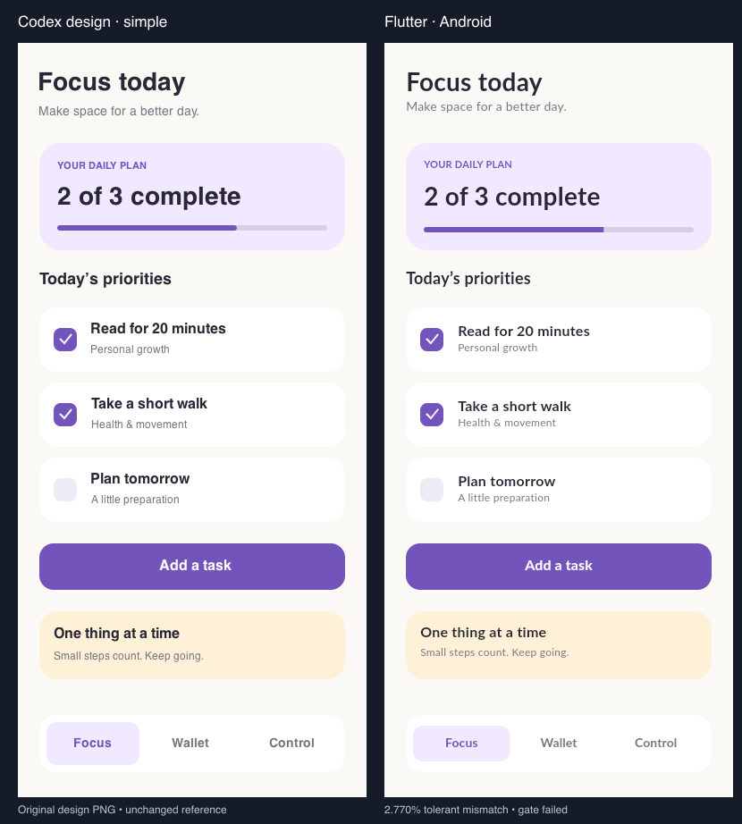
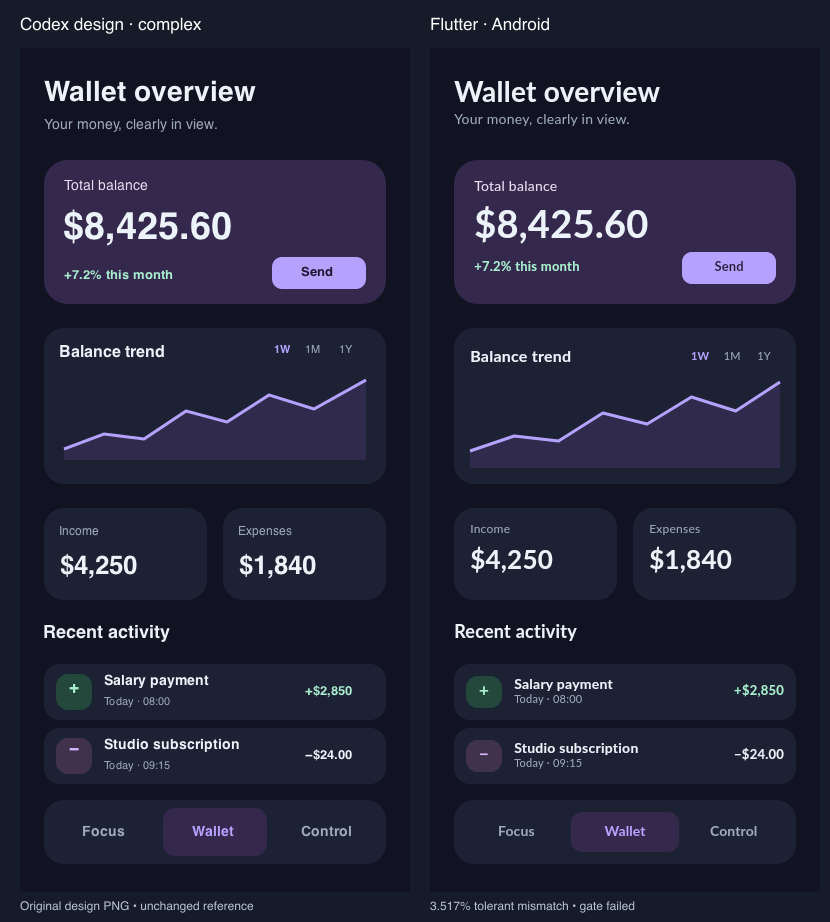
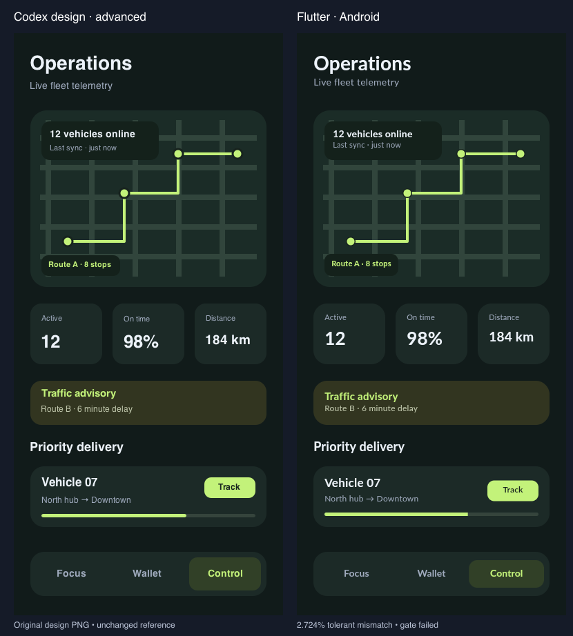

# Flutter Fidelity

Build Flutter UI from a screenshot or Figma design with the coding agent you
already use. Flutter Fidelity helps the agent reuse your widgets, implement the
screen in your app, and compare a fresh capture against the design.

The skill, CLI, and MCP server all use the same name: `flutter-fidelity`.
You can use the skill with Claude Code, Codex, Pi, or another agent that supports
[Agent Skills](https://agentskills.io/specification) and can inspect images, edit
files, and run local tools. Your agent writes the Dart; Flutter Fidelity handles
the measurements and reports.

## Get started

You need Node.js 22+ and a coding agent with image inspection. Use your existing
Flutter SDK for analysis, tests, and captures. Image inspection and comparison
can run without Flutter.

From your Flutter app's directory, install the tools and skill:

```sh
npm install --save-dev github:rebink/flutter-fidelity
npx skills add ./node_modules/flutter-fidelity --skill flutter-fidelity
```

Choose your agent in the installer. Both commands default to the current
project. Allow npm lifecycle scripts so the Git package can build. The package
includes its compiler and Node type definitions even when development
dependencies are omitted, as they are during Pi installation.
If your project has no `package.json`, npm creates one for this development tool;
your app continues to use `pubspec.yaml` for its Dart dependencies.

The skill comes from the installed package so its version matches the tools.
This installs from the repository's source branch. For a reproducible team setup,
pin the Git dependency to an existing commit or release tag and commit the
lockfile. Reload your agent's skills if the new entry does not appear.

Then attach a design and ask:

```text
Use Flutter Fidelity to implement this screenshot in my app. Reuse our existing
widgets and theme, then capture the screen and report the remaining differences.
```

For a smaller change:

```text
Use Flutter Fidelity to fix the heading font and wrapping to match this design.
```

You can also select the skill explicitly:

| Agent | Invocation |
| --- | --- |
| Claude Code, standalone skill | `/flutter-fidelity` |
| Codex CLI or IDE | `$flutter-fidelity` |
| Pi | `/skill:flutter-fidelity` |
| Other compatible agents | Select the installed skill or ask for Flutter Fidelity by name |

The skill uses connected MCP tools when available and otherwise runs the CLI.
You do not need to configure MCP for the PNG or Figma REST workflow. Its launcher
finds the engine in the project's `node_modules`, including from nested folders,
and checks that the skill and engine versions match.

See [setup](docs/setup.md) for agent selection, an existing checkout, optional
MCP connections, and troubleshooting. Installing only the skill does not install
the measurement engine.

### Pi package installation

Pi users can install the skill and MCP tools together:

```sh
pi install --local git:github.com/rebink/flutter-fidelity
```

Restart Pi, complete its project trust step, and check `/mcp` for
`flutter-fidelity`. The adapter requires native `registerMcpServer` support and
has package integration coverage for the API used by Pi 1.2.0.
[Pi setup](docs/pi.md) covers local checkouts, updates, and troubleshooting.

### Agent and platform support

The shared skill contains no required Pi, Claude, or Codex runtime API.
The package includes a Pi adapter, Claude Code plugin files, and portable/Codex
plugin manifests. Any compatible local MCP client can run the same stdio server.

Package tests cover relocated tools, standalone skill files, CLI execution,
and MCP transport. They do not establish that every agent version loads the
skill correctly or that every model produces the same UI. See the
[verification record](docs/verification.md) for what was actually tested.

The tools need filesystem and process access in the environment containing the
Flutter app. Cloud and browser agents need that access through their execution
environment or a suitable local connection. Native captures also need Android
tooling or Xcode and an available device or simulator. Host OS support and
Flutter target support require their own checks; a widget capture does not
verify an Android, iOS, desktop, or web build.

## What happens during a task

For a design-driven build, the agent first checks for a PNG or Figma URL and
requests one if missing. It then asks whether you want to review the UI approach
and widget list or proceed without widget review. A choice already given for
the task carries forward.

The agent reads the design and traces a comparable feature in your app before
editing Dart. It follows your existing architecture, state management, routes,
and theme. Prototype data stays labeled; integrated features use the app's
confirmed data and interaction contracts.

Before creating widgets, the agent searches the project widget catalog and
reviews similar components. Catalog entries keep reference crops, Dart symbols,
parameters, variants, and source hashes. Repeated instances can share one
implementation. Independent widget jobs can run through the host's subagents;
hosts without delegation follow the same plan sequentially.

Before implementation, you get a brief layout idea and a list of widgets to
create, reuse or adapt, including existing component names/source paths and
reasons. If you choose review, the agent resolves your feedback and waits for
approval of the updated plan before editing app code or assigning implementation
workers. If you skip review, it shares the summary and continues directly.

The agent then runs the relevant checks, captures the implemented screen, and
compares it against the original PNG. Repair rounds keep fresh captures and a
record of the source used for each result. A visual improvement cannot erase a
failed interaction or accessibility check.

The [workflow guide](docs/workflow.md) explains the full loop. More focused
guidance covers [architecture](docs/flutter-ui-architecture.md),
[widget reuse](docs/widget-catalog.md), [UI patterns](docs/flutter-ui-patterns.md),
and [performance measurement](docs/performance.md). The pattern guidance draws
on a documented [Flutter skill survey](docs/flutter-skill-research.md).

## Start with a PNG or Figma link

A PNG is enough to begin. The reference image stays unchanged and remains the
visual authority. Figma or Sketch structure can help explain a design, but is
optional.

For a Figma link, the skill checks four routes in order: connected Figma MCP
(local first, then an already connected remote MCP), Fidelity REST token, Figma
desktop with the Flutter Fidelity Bridge plugin, then Playwright. It skips
unavailable routes, preserves failure reasons and stops at the first validated
reference. REST intake needs `FIGMA_ACCESS_TOKEN` with
`file_content:read` and access to the file, supplied securely to the launching
process. It saves a frame PNG and scoped styling JSON without opening Figma or
copying CSS. Exports are pinned to the design revision; reuse checks the live
revision and saved PNG hash before copying an unchanged reference into a new
intake directory. Original artwork and fonts are separate inputs.

The desktop/plugin check verifies an existing
[Figma plugin connection](docs/figma-plugin.md); a running app alone is not enough.
The skill asks before opening or pairing it and skips to Playwright if unavailable
or declined. This route requires a persistent MCP connection and Figma to remain
open. Browser or clipboard export is the last resort when available.
See [design intake](docs/design-intake.md) for access, assets, and recovery.

For browser acquisition, [parallel headless Playwright workers](docs/figma-browser.md)
can collect different nodes without taking over the desktop. Three isolated
sessions share an authentication snapshot by default (maximum six). The agent
inspects the editor once, then supplies observed selectors and scoped node IDs.
This retains browser-visible properties and an optional original PNG export;
collapsed/virtualized layers and unavailable fields remain incomplete. Chromium
is optional, and live Figma compatibility still needs verification for the active
editor/account. On 403 or a sign-in redirect, the skill asks permission to open a
separate visible Chrome session, asks you to log in, waits for confirmation, and
resumes with private saved authentication. If headless access remains blocked,
it can continue visibly with your permission (`headless: false`, one worker).
Your everyday Chrome profile is untouched; login is not guaranteed to resolve
CloudFront blocking. See [manual login recovery](docs/figma-browser.md#manual-login-recovery).
This route does not remove file permissions or API limits.

The agent establishes the logical viewport, export scale, crop, and safe insets
from supplied dimensions or reliable source evidence. A 2x or 3x PNG does not
have the same pixel and logical dimensions. Missing product behavior, original
assets, or fonts stay explicit. The agent attempts asset recovery and checks
existing components before asking for the remaining decisions in a batch.
[Design clarification](docs/design-clarification.md) explains those decisions.

## Read the result

Each comparison produces an HTML report with overlays, blink inspection,
difference maps, region metrics, and the capture environment. It retains failed,
incomplete, and untested evidence.

The agent presents the original design and generated Flutter UI side by side,
with image/report links and a **visual fidelity percentage** calculated as
`100 × (1 − tolerant pixel mismatch ratio)`. This percentage describes pixel
agreement; the separate visual and product statuses still account for required
regions, geometry, text and executed checks. Missing measurements show **N/A**;
percentages with incomplete verification are labeled diagnostic. See
[comparable results](docs/workflow.md#comparable-results) for presentation details.

| Comparison exit code | Meaning |
| --- | --- |
| `0` | Visual fidelity passed |
| `1` | Visual fidelity failed |
| `2` | Required visual evidence is incomplete |

Visual fidelity and product acceptance are separate. Consumers that need the
combined result must also inspect `acceptance.status` in the report. A matching
PNG alone cannot prove that controls work, text is accessible, or the layout
adapts to other widths.

Comparison policy v3 includes required text-overflow evidence. Repair policy v2
protects passed product checks and tracks the selected source/report pair;
`bestReport` is the delivery choice, while `bestVisualReport` can describe a
candidate with broken behavior. Source checkpoints let the agent verify the
owned files before a fresh capture. Legacy active repair sessions must finish
with their matching tool release and retain their repair budget. See
[comparison and repair](docs/workflow.md#comparison-and-repair) and
[source binding](docs/workflow.md#source-checkpoint-binding).

## Use the CLI directly

Run commands from your Flutter project. For a local package installation:

```sh
node node_modules/flutter-fidelity/dist/cli.js --version
node node_modules/flutter-fidelity/dist/cli.js doctor
```

For tool development, clone this repository and build it:

```sh
git clone https://github.com/rebink/flutter-fidelity.git
cd flutter-fidelity
npm ci
npm run check
```

`npm ci` builds through the prepare hook. If lifecycle scripts were disabled,
run `npm run build`. From this checkout, a reference/capture/comparison sequence
looks like this:

```sh
node dist/cli.js validate-assets --files ./assets/hero.png ./fonts/Lato-Regular.ttf
node dist/cli.js suggest-viewport --image your-screen.png
node dist/cli.js import-image --image your-screen.png --out .fidelity/reference \
  --width 390 --height 844 --confirmed \
  --fonts ./fonts/Lato-Regular.ttf ./fonts/Lato-Bold.ttf --assets ./assets/hero.png
node dist/cli.js inspect --bundle .fidelity/reference --spec visual-spec.json
node dist/cli.js capture --bundle .fidelity/reference --config capture.json --out .fidelity/capture-1
node dist/cli.js compare --bundle .fidelity/reference --actual .fidelity/capture-1/actual.png \
  --capture .fidelity/capture-1/capture.json --out .fidelity/report-1
node dist/cli.js record-iteration --session .fidelity/session.json --report .fidelity/report-1
```

Confirm the dimensions before using `--confirmed`. Crop coordinates use original
PNG pixels. The agent supplies the reviewed visual spec and capture entrypoint;
the CLI does not infer a layout or generate Dart. Use new output directories for
every import, capture, and report. Existing directories are never overwritten.

A local MCP client can launch the engine with:

```sh
node /absolute/path/to/flutter-fidelity/dist/cli.js mcp
```

The server exposes nineteen tools. Its stdout carries the MCP protocol;
diagnostics go to stderr. Optional official Dart MCP needs an SDK that supports
`dart mcp-server`; it is separate from this server and is not required for image
tools or the custom capture workflow.

## Try the examples

The [Flutter example](flutter/example) includes a screen and development capture
harness. After building the tools, run:

```sh
cd flutter/example
flutter pub get
cd ../..
node dist/cli.js import-image --image fixtures/screens/complete-screen.png \
  --out .fidelity/example-reference --width 390 --height 844 --confirmed \
  --fonts fixtures/fonts/Lato-Regular.ttf fixtures/fonts/Lato-Bold.ttf
node dist/cli.js capture --bundle .fidelity/example-reference \
  --config examples/capture.widget.json --out .fidelity/example-capture
```

The example is an independently implemented screen. Comparing it exposes its
remaining differences. Native Android/iOS runs need platform scaffolding, a
device or simulator, matching font bytes, and the integration capture driver.

The Codex Gallery has three original CC0 references and runnable Flutter
implementations. Each image shows the unchanged reference on the left and a
native Android capture on the right, at 390×844 logical app-content size.
Codex created the references before implementing the Dart screens. The apps
use real text, controls, and vector drawing.

### Focus today

Task completion, progress, and task creation.



### Wallet overview

An interactive chart, range selection, transactions, and demo payments.



### Operations

Route visualization, vehicle status, telemetry, traffic advice, and tracking.



| Screen | Android tolerant pixel mismatch | Fidelity result |
| --- | --- | --- |
| Focus today | 2.770% | Failed |
| Wallet overview | 3.517% | Failed |
| Operations | 2.724% | Failed |

The recorded gallery run passed static analysis, 31 widget tests, and three
native Android interaction tests. All screens still failed the 1% whole-screen
fidelity threshold. Accessibility failures remain recorded; iOS was not tested.
[Run the gallery and inspect its reports](demos/codex-gallery/README.md).

The [Fieldnotes feed](demos/fieldnotes-feed/README.md) includes 19 state/widget
tests, Android interaction and capture evidence, and preserved repair rounds.
Its recorded native mismatch is 6.474%, with a failed fidelity result and
separate accessibility findings. Earlier
[Open Wellness examples](demos/open-wellness/README.md) and
[CC0 UI kit options](docs/free-ui-resources.md) are also available.

To run a demo, enter its `app/` directory and use `flutter pub get`,
`flutter run`, and `flutter test test/ui_test.dart`. Capture-specific tests need
the CLI's `FIDELITY_REQUEST`. Replace machine-specific Flutter paths in capture
configs with your installed SDK or `flutter` on PATH.

## Updates and development

The tools, plugin manifests, and [skill](skills/flutter-fidelity/SKILL.md) share
one release version. If you upgrade a project dependency, install the skill
again from that package so the versions stay together:

```sh
npm install --save-dev github:rebink/flutter-fidelity
npx skills add ./node_modules/flutter-fidelity --skill flutter-fidelity
```

For a clean source clone, `npm run update:check` reports upstream changes and
`npm run update` fast-forwards, installs locked dependencies, and runs checks.
Reload your host or MCP process afterward. See [updates](docs/updates.md) and
[release notes](CHANGELOG.md), including migration from the old `flutter-ui`
skill name.

Run the core checks with:

```sh
npm run check
```

After changing comparator images or policy, generate a fresh fixture corpus
and calibration report:

```sh
npm run fixtures -- --out .fidelity/fixtures-new
npm run benchmark -- --fixtures .fidelity/fixtures-new --out .fidelity/calibration-new
```

The twelve synthetic fixtures test the comparator against deliberate defects.
Calibration results do not measure how accurately an agent generates Flutter.
Cross-agent evaluation needs real capture manifests:

```sh
npm run benchmark -- --manifest your-runs.json --out .fidelity/agent-evaluation
```

See the [benchmark protocol](docs/benchmark.md),
[skill evaluation cases](docs/skill-evaluation.md), and
[verification record](docs/verification.md).

Source lives in `src/`; agent adapters and manifests wrap the same engine.
`skills/flutter-fidelity/` contains the portable skill, CLI launcher, and internal
guides. Its documentation copies come from `docs/`; after editing those sources,
run `npm run skill:sync`. The check command detects stale copies.
`flutter/fidelity_harness/` is development-only. Fixtures, scripts, and demos
keep their evidence separate from production app code.

The current scope is local assistant workflows for Flutter mobile UI. Backend
generation, native platform views, complex shaders and animation, an independent
model runner, and a bundled browser are outside this release. Runtime app code
does not depend on the capture harness. No universal pixel-perfect generation
rate has been established.

## License

Project code uses the [MIT license](LICENSE). Open Wellness and Codex Gallery
design sources and reference PNGs are CC0
([Wellness](demos/open-wellness/design/LICENSE),
[Gallery](demos/codex-gallery/design/LICENSE)) and can be reused commercially
without attribution. Bundled fonts retain their OFL licenses; dependencies
retain their own notices.
