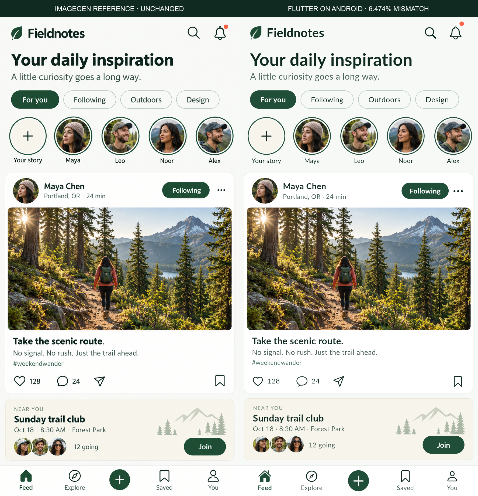

# Fieldnotes · complex ImageGen feed implemented in Flutter

The reference was created with the built-in image_gen.imagegen tool before Dart implementation. The unchanged PNG is **887 × 1774**. We selected a **400 × 800 logical app-content viewport**, export ratio **2.2175**, locale en-US and zero capture safe insets. No scoring input was resized, stretched or aligned.



The implementation uses our screenshot-to-Flutter, typography, visual-repair and verification skills. Photos, avatars and isolated leaf/mountain artwork were extracted through crop_asset. All text and controls are real Flutter widgets. Original font and icon source files are unavailable for an ImageGen raster: Lato and Cupertino outline icons are explicit inferred choices, with uncertainty retained.

## Run the local demo

```sh
cd app
flutter pub get
flutter run
flutter test test/controller_test.dart test/ui_test.dart
```

Verified with the existing Flutter 3.24.0 / Dart 3.5.0 SDK. The local capture configurations identify that SDK explicitly. To use another machine, replace their flutter path and projectRoot/deviceId as needed; preserve the reference profile. Capture entrypoints require the CLI's FIDELITY_REQUEST. Production lib/main.dart does not import the harness.

The final debug APK is built explicitly from **lib/main.dart**, rather than the integration test. The source ZIP retains the repository-relative development harness dependency and includes the companion CLI/skills. Extract the archive, then use demos/fieldnotes-feed/app.

## Local interaction contract

- Category filtering, likes and saved-post navigation use stable post IDs.
- Comment submission increments the local count; post creation validates nonempty text and prepends the entered content.
- Join/leave toggles the event between 12 and 13 attendees.
- Search, stories, profile, notification and share panels are local demo previews. No external share, upload, backend or persistence is implied.

State lives in FeedController; the view composes named header, story, post, event, navigation and sheet components. Palette/type styles have a feature theme owner. Forms own/dispose controllers and remain scrollable above the keyboard. Long text grows content instead of clamping system scaling.

## Measured results

| Capture | Tolerant pixel mismatch | Exact RGBA mismatch | Design-fidelity result |
| --- | --- | --- | --- |
| Retained widget candidate | 6.486% | 70.531% | Failed |
| Fresh Android capture | 6.474% | 70.514% | Failed |

The policy remains v2: 1% whole-screen, 3% required-region mismatch, and one logical pixel of geometry error. The photo region passes, but whole-screen, text/control regions and inferred typography evidence do not establish acceptance. Pixel mismatch is not an overall accuracy percentage. Background raster texture, font shape/leading, icons and avatar/event details remain different. This is one controlled ImageGen demo, not a comparative skill benchmark.

| Widget candidate | Tolerant mismatch | Result |
| --- | --- | --- |
| 1 | 34.016% | failed |
| 2 | 18.262% | failed |
| 3 | 7.059% | failed |
| 4 | 7.054% | failed |
| 5 | 6.486% | failed |

Five candidate captures exhausted the configured repair budget. record_iteration retained round 5; its code checkpoint and reports remain under runs/. No new visual repairs were performed after stopping. Android verification used the same Flutter UI code and a fresh native capture.

## Verification and limits

- Flutter analysis: passed. Five controller tests and fourteen widget tests passed; the latter include four user flows, nine separate width/text-scale cases and an evidence recorder.
- Widths 360/400/430 and scales 1/1.5/2: no reported overflow; the event and navigation remained reachable in the executed tests.
- Android integration flow: like, save, saved navigation, join and post creation passed. The fixture was reset before its accepted fresh capture.
- Widget accessibility labels passed. Android/iOS target-size guidelines and contrast failed, as recorded in artifacts/accessibility.json. A passing recorder test does not turn those findings into passes. Native screen-reader and native accessibility checks were not run.
- iOS rendering/interactions and profile-mode performance were not run.
- Core/MCP tests: 22 passed. Example UI tests: 10 passed. Comparator calibration: 12/12 passed in a new isolated working directory, preserving existing reference PNGs; this does not measure model-generation accuracy.
- Standalone source archive dependency resolution and analysis passed.

Native device: Pixel_8_API_36, Android 16 / API 36, temporary framebuffer 1200 × 2400 at density 480. API 28+ shortEdges window configuration lets the app surface include the emulator cutout area; production SafeArea remains enabled. The capture checks the actual 400 × 800 app-content viewport before painting. Earlier native scroll/dimension failures remain preserved, and were not substituted as accepted images. Original resolution/density settings are restored after verification.

## Inspect the evidence

- [Original reference](design/reference.png), [exact generation prompt](design/imagegen-prompt.txt), [provenance](design/imagegen-provenance.json), [decisions and architecture plan](design/decisions.json).
- [Actual Android image](artifacts/flutter-android.png), [Android comparison report](artifacts/android-report/index.html), [widget report](artifacts/widget-report/index.html).
- runs/ contains fresh captures, actual font/image/reference hashes, SDK metadata, measured region rectangles, failed attempts and checkpoints.
- device-profile.json names the actual device configuration. Accessibility and performance claims retain their individual scope.

The project code uses the repository's MIT license. Bundled Lato fonts retain their OFL notice; cupertino_icons retains its package license. The reference and isolated image crops originate from this task's image generation, not third-party UI screenshots.
